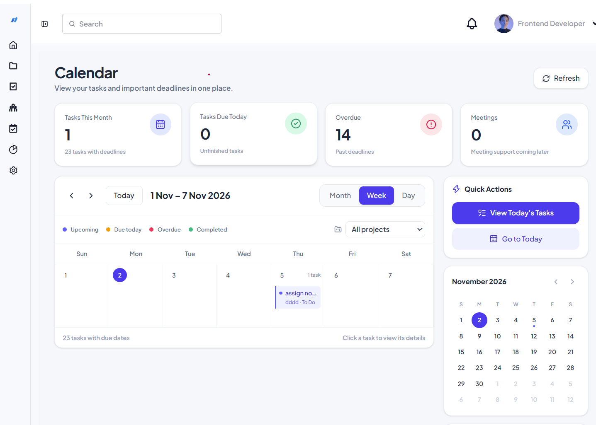

# DevFlow

**Plan projects, organize tasks, and keep your team in sync.**

DevFlow is a project and task management web app for development teams. It brings project progress, task ownership, team activity, and schedules into one workspace—so teams can spend less time piecing together updates and more time delivering work.

## Screenshots

| Calendar | AI task generation |
| --- | --- |
|  |  |

### Team management


## Demo

[▶ Watch the DevFlow showcase video](https://github.com/chandan-chakma/DevFlow/raw/refs/heads/main/public/demo.mp4)

## The problem

Project updates often end up scattered across conversations, task lists, and calendars. That makes it harder to answer basic questions: What is in progress? Who owns the next step? Has a deadline changed? DevFlow provides a shared workspace where teams can see projects, tasks, schedules, and activity together.

## Features

- **Project overview:** Browse projects and open a project workspace for its details, members, tasks, and activity.
- **Task tracking:** Review and manage tasks, with a visual workflow for moving work through its stages.
- **Team collaboration:** View team members and project participation, with role-aware dashboard access.
- **At-a-glance dashboard:** See project and task summaries, charts, recent projects, and your tasks in one place.
- **Calendar and activity views:** Keep track of upcoming work and see recent project activity.
- **Real-time notifications:** Receive in-app notifications through the Socket.IO connection.
- **Account access:** Register and sign in with email and password using Firebase Authentication.
- **Product landing page:** Learn about DevFlow, browse its feature and pricing sections, and view testimonials.

## Tech stack

- React 19
- Vite
- React Router
- Tailwind CSS and daisyUI
- TanStack Query and Axios
- Firebase Authentication
- Socket.IO client
- Recharts
- dnd-kit

## Getting started

### Prerequisites

- Node.js and npm (use a Node.js version supported by the installed Vite release)
- A Firebase project with Firebase Authentication configured

### 1. Clone and install

```bash
git clone https://github.com/chandan-chakma/DevFlow.git
cd DevFlow
npm install
```

### 2. Configure Firebase

Create a `.env` file in the project root and add the Firebase web app configuration values:

```env
VITE_apiKey=
VITE_authDomain=
VITE_projectId=
VITE_storageBucket=
VITE_messagingSenderId=
VITE_appId=
```

Fill in each value from your Firebase project's web app settings. Add `localhost` to the authorized domains for Firebase Authentication during local development. Do not commit your `.env` file.

### 3. Start the development server

```bash
npm run dev
```

Open the local URL printed by Vite in your terminal.

## Available scripts

| Command | Description |
| --- | --- |
| `npm run dev` | Start the Vite development server |
| `npm run build` | Create a production build in `dist/` |
| `npm run preview` | Preview the production build locally |
| `npm run lint` | Run ESLint |

## Backend connection

The frontend currently connects to the DevFlow API hosted at `https://devflow-server-kin7.onrender.com/`. The same service is used for Socket.IO notifications. If you run a different backend, update the API base URL in `src/Hooks/UseAxiosSecures.jsx` and the Socket.IO URL in `src/Socket/socket.js`.

## Project structure

```text
src/
├── AuthProvider/       # Firebase authentication state and actions
├── Components/         # Landing page and dashboard components
├── Firebase/           # Firebase app and Authentication setup
├── Hooks/              # Authentication, API, and role hooks
├── layouts/            # Public, auth, and dashboard layouts
├── pages/              # Landing, authentication, and dashboard pages
├── Route/              # Application routes and protected-route handling
└── Socket/             # Shared Socket.IO client
```

## License

See [LICENSE](./LICENSE) for license details.
